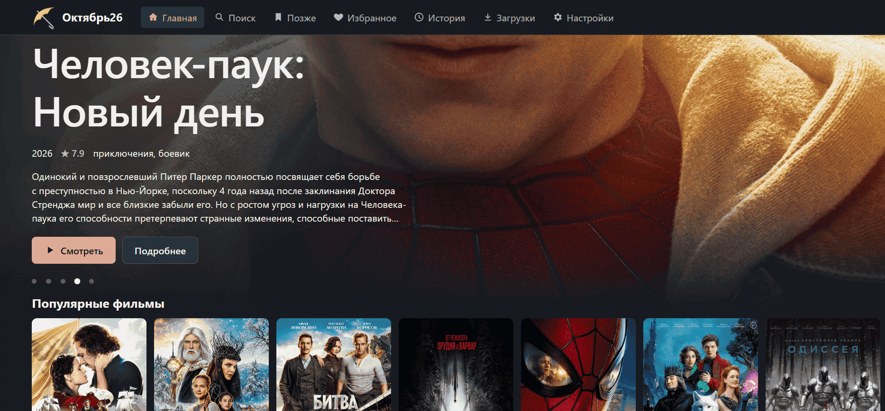

  

  Реально домашний кинотеатр на телевизоре, компьютере или роутере: поиск фильмов и
  сериалов по публичным трекер-поисковикам, просмотр раздачи сразу, пока она качается,
  и хранение скачанного на диске устройства, флешке или сетевом диске в домашней сети.
  Без рекламы, аккаунтов и VPN.

  
  

  

## Платформы

| Платформа | Бейдж | Файл в релизе | Установка |
|---|---|---|---|
| Роутер Netcraze / Keenetic |  | `october26-router-ВЕРСИЯ.zip` | [инструкция](#роутер-netcraze--keenetic) |
| Компьютер с Windows |  | `october26-desktop-ВЕРСИЯ.zip` | [инструкция](#компьютер-с-windows) |
| Телефон, планшет, телевизор |   | `october26-android-ВЕРСИЯ.apk` | [инструкция](#android-и-android-tv) |

Приложения для телевизора и для ПК самостоятельные: каждое само ищет, качает и
показывает фильмы, роутер им не нужен. Скачанное они могут хранить на сетевом
диске в домашней сети — роутере с USB-диском, NAS или другом компьютере:
**Настройки → Хранилище фильмов → Сетевые диски**. Октябрь 26 на роутере или ПК
открывается и с других устройств той же сети: телефона, iPad, браузера. Прогресс,
«Позже» и «Избранное» у каждого устройства свои. Пароля и регистрации нет.

На телевизоре первый запуск предлагает выбрать хранилище или пропустить его,
назвать устройство и ввести ключ Kinopoisk Unofficial. Без хранилища скачивание
скрыто, просмотр работает через ограниченный временный буфер. Подробнее:
[настройка телевизора](docs/tv.md).

## Скриншот

## Вкладки

| Вкладка | Что здесь |
|---|---|
| **Главная** | Витрина: «Продолжить просмотр», «Для вас» (подборки по жанрам из истории) и остальные ряды с постерами. Без ключа Кинопоиска или TMDB показывает, как его подключить |
| **Поиск** | Поиск раздач по всем включённым источникам |
| **Карточка** | Фильм или сериал: описание, список серий и раздачи с выбором качества. Кнопка «Смотреть» сама выбирает раздачу по настройкам |
| **Позже** | Список «Посмотреть позже» |
| **Избранное** | Фильмы и сериалы, отмеченные сердечком |
| **История** | Просмотренные карточки; историю можно очистить |
| **Загрузки** | Раздачи, которые хранятся на диске: скачанные целиком или кнопкой «Скачать» |
| **Настройки** | Источник описаний, какую раздачу выбирать сразу, источники раздач, хранилище фильмов и сетевые диски, профиль этого устройства, адреса для других устройств, приложение для ТВ, оформление |

## Установка

Готовые пакеты лежат на странице [релизов](https://github.com/Dezodemius/October26/releases).
В каждом архиве есть файл `Инструкция.md` — та же инструкция, что ниже, только подробнее.

### Роутер Netcraze / Keenetic

Понадобятся компьютер с Windows в той же сети и подключённые к роутеру SSD
(система и база, около 120 ГБ) и HDD (фильмы). Занимает около 20 минут.
Подробности и решение проблем — в [инструкции для роутера](docs/router.md).

1. **Компоненты.** В веб-интерфейсе роутера (http://192.168.1.1) откройте
   **Управление → Общие настройки → Изменить набор компонентов**. Отметьте
   OPKG, Ext и SMB (а также NTFS, если HDD в NTFS) и нажмите **Установить обновление**.
   Роутер перезагрузится.
2. **SSD.** **Управление → Хранилища и устройства → ⋮ → Инициализировать → EXT4**.
   ⚠️ SSD очистится полностью: скопируйте с него нужное заранее.
3. **Entware.** Скачайте [установщик для arm64](https://bin.entware.net/aarch64-k3.10/installer/aarch64-installer.tar.gz)
   и положите архив без распаковки в папку `install` в корне раздела SSD
   (через `\\192.168.1.1` в Проводнике Windows). Затем в **OPKG** выберите
   раздел SSD и нажмите **Сохранить**. Установка закончена, когда в системном
   журнале появится «Установка системы пакетов "Entware" завершена!».
4. **Октябрь 26.** Распакуйте `october26-router-ВЕРСИЯ.zip` и дважды щёлкните
   **`Установить на роутер.cmd`**. На запрос пароля введите пароль Entware:
   по умолчанию `keenetic`. Скрипт сам выберет HDD для фильмов, включит
   автозапуск и перезапустит Октябрь 26 при сбое.
5. **Открыть.** http://192.168.1.1:8095 в любом браузере. На iPad в Safari:
   **Поделиться → На экран «Домой»**, и Октябрь 26 откроется как отдельное приложение.

**Обновление:** откройте **Настройки → Обновления**. Автоустановка изначально
выключена; включите её в этом разделе. Можно также обновить приложение вручную.
Настройки, прогресс и фильмы сохранятся.

### Компьютер с Windows

1. Скачайте `october26-desktop-ВЕРСИЯ.zip` и распакуйте в любую папку, например `Документы\Октябрь 26`.
2. Дважды щёлкните `october26.exe`. Если Windows скажет «защитила ваш компьютер»,
   нажмите **Подробнее → Выполнить в любом случае**: программа не подписана.
   Брандмауэр спросит доступ к сети: разрешите для **частных сетей**.
3. Откройте http://localhost:8095. С телефона или телевизора из той же сети
   используйте адрес из окна программы, например `http://192.168.1.20:8095`.
4. FFmpeg и FFprobe уже входят в архив рядом с `october26.exe`. Для просмотра в браузере дополнительных программ устанавливать не нужно.

Окно программы с журналом должно оставаться открытым. Фильмы по умолчанию
лежат в папке `media` рядом с `october26.exe`. Другой диск или сетевую папку
выбирают в **Настройки → Хранилище фильмов**. Подробности — в [инструкции для Windows](docs/desktop.md).

**Обновление:** откройте **Настройки → Обновления**. Автоустановка изначально
выключена; включите её в этом разделе. Для ручного обновления скачайте новый
архив, закройте Октябрь 26 и скопируйте в папку программы всё его содержимое с
заменой файлов. Настройки, база и фильмы сохранятся.

### Android и Android TV

Нужен Android 11 или новее: телевизор, телефон или планшет.

1. Скачайте `october26-android-ВЕРСИЯ.apk` со страницы релизов. Если Октябрь 26
   стоит на роутере, APK можно взять и с него: http://192.168.1.1:8095/tv.apk.
2. Разрешите установку из неизвестных источников для приложения, которым
   открываете APK, и установите файл.
3. Запустите Октябрь 26. Приложение работает само по себе: ищет, качает и
   показывает фильмы прямо на устройстве, роутер и ПК не нужны.

Фильмы по умолчанию хранятся в памяти устройства. Флешку или сетевой диск
(NAS, роутер с USB-диском, другой компьютер) выбирают в **Настройки → Хранилище
фильмов**: кнопка **Найти в сети** сама находит общие папки в домашней сети.
Свёрнутое приложение продолжает качать в фоне, а выход кнопкой «Назад»
останавливает его.

В разделе **Настройки → Обновления** можно проверить и установить новую версию.
При включении автоматической загрузки APK скачивается сам; установку нужно
подтвердить в системном окне Android.

Версии, выпущенные под именем «Кинодом», ищут на GitHub файл
`kinodom-android-…apk` и переименованный APK не видят. Их обновите один раз
вручную.

### Ключ для описаний и постеров

Витрина, постеры и описания берутся с Кинопоиска или TMDB, и для этого нужен
бесплатный ключ. Его вводят один раз в **Настройки → Описания и постеры**.
Если Октябрь 26 стоит на роутере или ПК, витрина сразу появится на всех
устройствах, которые его открывают. Без ключа поиск раздач и просмотр работают,
но главная пустая.

**Кинопоиск** (проще, работает из РФ):

1. Зарегистрируйтесь по почте на [kinopoiskapiunofficial.tech](https://kinopoiskapiunofficial.tech).
2. Подтвердите почту по ссылке из письма и войдите на сайт.
3. В профиле скопируйте токен, он похож на `8c8e1a50-6322-4135-8875-5d40a5420d86`.
4. В Октябрь 26 откройте **Настройки**, выберите источник **Кинопоиск**,
   вставьте токен в поле **Ключ Кинопоиска** и сохраните.

**TMDB** (если Кинопоиск не подходит; из РФ сайт иногда открывается только через VPN):

1. Зарегистрируйтесь на [themoviedb.org](https://www.themoviedb.org/signup).
2. Откройте [Настройки → API](https://www.themoviedb.org/settings/api), запросите
   ключ для разработчика и заполните короткую анкету. Тип использования — личный.
3. Скопируйте **Ключ API** (v3) или **Токен доступа** (v4), подойдёт любой.
4. В **Настройках** Октябрь 26 выберите источник **TMDB**, вставьте ключ и сохраните.
   Если основной адрес TMDB заблокирован, там же можно указать зеркала.

## Ошибки и предложения

Нашли ошибку или хотите новую возможность — [создайте issue](https://github.com/Dezodemius/October26/issues/new/choose).
Для ошибки укажите версию, устройство (роутер, Windows, Android) и что именно
происходит; скриншот или кусок журнала из окна программы очень помогают.
